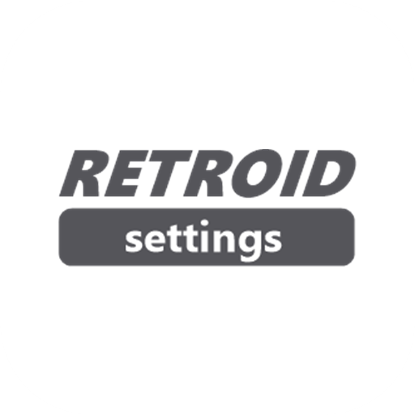
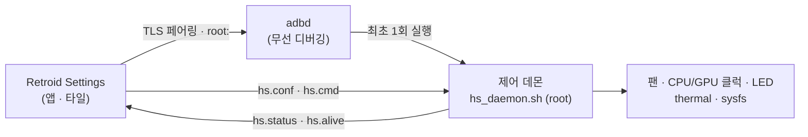

<div align="center">



# Retroid Settings

**LineageOS 24를 올린 Retroid Pocket 6를 순정 Retroid 펌웨어처럼 쓰기 위한 앱**

팬 · TDP · 강제 전체 화면 · 화면 밀도 · 컨트롤러 캘리브레이션 등.

[English](README.md) · **한국어**


-167C80)

</div>

---

## 왜 만들었나요?

순정 Android 13 펌웨어에서 LineageOS로 바꾸면 최신 Android를 쓸 수 있지만, 순정 Retroid 도구가 하던 편의 기능이 사라져요. 팬 곡선, TDP 프로필, 앱을 전체 화면으로 늘리기, 순정 같은 홈 화면 배치 같은 것들이요.
Retroid Settings는 이런 기능을 되살려 순정 펌웨어처럼 쓸 수 있게 해 줘요. LineageOS에 이미 있는 설정(컨트롤러 배열, 트리거 방식, 조명, 주사율)은 시스템 설정에 그대로 둬요.

## 주요 기능

| | 기능 | 설명 |
|---|---|---|
| 🌡️ | **온도** | CPU · GPU · 배터리 온도와 현재 팬 단계를 실시간 표시 |
| ⚡ | **TDP** | 무제한 / 절전 / 균형 / 성능 / 사용자(CPU·GPU 최대 클럭 %) |
| 🌙 | **화면 꺼지면 절전** | 화면이 꺼지면 CPU/GPU 50% 제한 · 팬 끄기, 켜면 즉시 복구 |
| 🌀 | **팬** | 시스템 / 부드럽게 / 수동 / 목표 온도 — 평균 온도와 단계별 변화로 팬이 들쭉날쭉하지 않음, 안전 온도에서는 무조건 최대 |
| 🧠 | **메모리** | 사용량, zRAM, 시스템 예약 영역과 많이 쓰는 프로세스 |
| 🔋 | **배터리** | 건강도, 실제 용량(6,000 mAh 기준), 충전 횟수, 충전 전력, 스틱 LED 배터리 표시(끄기 / 항상 / 충전 중) |
| 🖥️ | **강제 전체 화면** | 세로 전용 앱·고정 비율 앱도 가로 전체 화면으로. 새로 설치한 앱도 자동 적용, 앱별 제외 가능 |
| 🔍 | **화면 밀도** | 기본 / 태블릿(288 dpi) — 순정처럼 대칭인 홈 화면과 6칸 독, 잠금화면 날짜를 왼쪽 위로 |
| 🎮 | **컨트롤러** | 버튼·스틱·트리거 입력 테스트, 끝까지 누르면 100%가 되도록 스틱·트리거 캘리브레이션 |
| 🧩 | **빠른 설정 타일** | 아래 표 참고 |
| 🌐 | **언어** | 한국어, 영어 |

### 빠른 설정 타일

탭하면 바로 바뀌고, **길게 누르면** 앱의 해당 카드(또는 시스템 설정)로 이동해요.

| 타일 | 탭 | 길게 누르기 |
|---|---|---|
| TDP | 무제한 → 절전 → 균형 → 성능 | TDP 카드 |
| 팬 | 시스템 → 부드럽게 → 수동 → 목표 온도 | 팬 카드 |
| 강제 전체 화면 | 켜기 / 끄기 | 전체 화면 카드 |
| 화면 밀도 | 기본 ↔ 태블릿 | 밀도 카드 |
| 화면 방향 | 가로 → 세로 → 세로(반대) | 전체 화면 카드 |
| 컨트롤러 배열 | Xbox ↔ Nintendo | Gamepad 설정 |
| 주사율 | 60 Hz ↔ 120 Hz | 디스플레이 설정 |

## 요구 사항

- **Retroid Pocket 6** (Snapdragon 8 Gen 2)
- **LineageOS 24 userdebug** 빌드 — 개발자 옵션에 **루팅된 디버깅**이 있어야 해요
- Wi-Fi (앱이 무선 디버깅으로 기기 자신의 adb에 접속해요)

## 설치

1. **개발자 옵션 켜기** — 설정 → 휴대전화 정보 → *빌드 번호* 7번 탭
2. 개발자 옵션에서 **루팅된 디버깅**, **무선 디버깅** 켜기
3. APK를 설치하고 첫 실행 때 **알림 권한 허용**
4. 오른쪽 위 상태 표시를 눌러 **[페어링]** → *무선 디버깅 → 페어링 코드로 기기 페어링* → 알림에 6자리 코드 입력
5. 상태 표시가 **root 연결됨**으로 바뀌면 끝

페어링 이후에는 앱이 알아서 처리해요. 필요한 권한을 스스로 받고, 태블릿 밀도·가로 고정·모든 앱 강제 전체 화면·잠금화면 날짜 위치를 적용하고, 재부팅할 때마다 다시 적용해요.

> 처음 적용할 때 화면 크기가 바뀌고 SystemUI가 한 번 재시작되어 화면이 잠깐 깜빡일 수 있어요.

## 언어

기기 언어를 따라가요. 한국어 기기에서는 한국어, 그 밖에는 영어로 표시돼요. 연결 창(오른쪽 위 상태 표시) → **언어**에서 바꿀 수 있고, *설정 → 앱 → Retroid Settings → 언어*와 같은 설정이에요.

새 언어 추가: `app/src/main/res/values/strings.xml`을 `values-<언어코드>/strings.xml`로 복사해 번역하고, `app/src/main/res/xml/locales_config.xml`과 `App.kt`의 `Lang.OPTIONS`에 언어를 추가하면 돼요.

## 앱 지우기 전에

연결 창 → **기본 상태로 되돌리기**를 누르면 이 앱이 바꾼 시스템 설정을 모두 되돌린 뒤 앱 삭제 화면을 열어요. 지운 다음 재부팅하면 깨끗한 상태가 돼요.

- 되돌리는 것: 제어 데몬, 팬 트립 포인트, CPU/GPU 제한, 스틱 LED, 캘리브레이션, 가로 고정, 화면 밀도, 앱별 강제 전체 화면, 잠금화면 날짜
- 그대로 두는 것: 시스템 설정에도 있는 값(컨트롤러 배열, 트리거 방식, 주사율, 자동 회전)과 *무선 디버깅 → 페어링된 기기*의 `Retroid Settings` 항목

## 참고

- 화면이 꺼지면 커널 드라이버가 스틱 LED 칩 전원을 끄기 때문에, 배터리 LED 표시는 화면이 켜져 있을 때만 보여요.
- 앱을 다시 설치하면 adb 키가 새로 만들어져서 페어링을 한 번 다시 해야 해요.

## 동작 방식



- 앱은 [LibADB Android](https://github.com/MuntashirAkon/libadb-android)로 기기 자신의 adbd에 접속해 `adb root`로 전환해요.
- 그 셸로 작은 **제어 데몬**을 한 번 띄우고 나면, 이후 설정 변경과 타일 동작은 데몬과 파일만 주고받아요. adb 연결 없이도 동작하고 반응도 빨라요.
- 데몬은 팬 단계, 클럭 제한, 새 앱 감지, 화면 꺼짐 절전, 배터리 LED를 맡아요. 하드웨어 경로(팬 장치, 온도 센서, 클럭 정책)는 실행할 때 직접 찾아서 써요.
- 화면이 꺼지면 데몬은 2초에 한 번만 깨어나고, 기기의 깊은 절전을 막지 않아요.

## 빌드

JDK 17과 Android SDK(Build-Tools 35)가 필요해요.

```bash
./gradlew assembleRelease
```

결과물은 `app/build/outputs/apk/release/app-release.apk`에 생겨요.

| 항목 | 버전 |
|---|---|
| Gradle / AGP | 8.11.1 / 8.7.3 |
| Kotlin | 2.1.21 |
| compileSdk / targetSdk / minSdk | 35 / 35 / 30 |
| UI | Jetpack Compose (Material 3 components) |

## 라이선스와 서드파티

사용한 라이브러리와 라이선스는 [THIRD_PARTY_NOTICES.md](THIRD_PARTY_NOTICES.md)에 정리되어 있어요.

Retroid와 Retroid Pocket은 각 소유자의 상표예요. 이 프로젝트는 Retroid나 LineageOS 프로젝트와 관련이 없는 개인 프로젝트예요.
