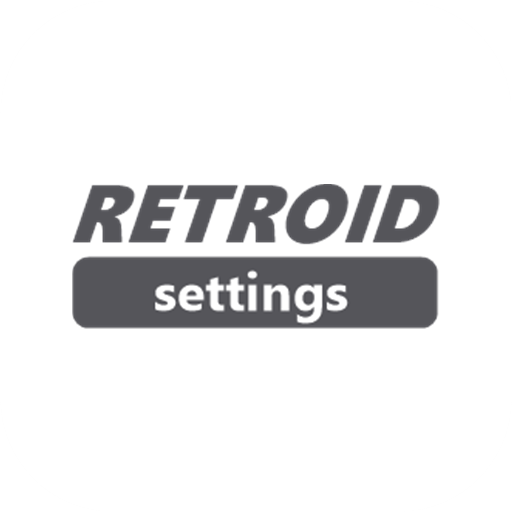
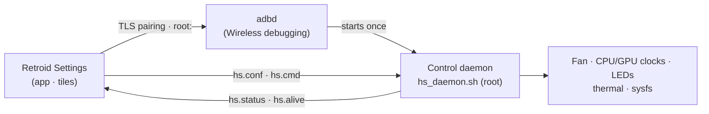

<div align="center">



# Retroid Settings

**Use a Retroid Pocket 6 running LineageOS 24 the way the stock Retroid firmware works**

Fan, TDP, forced full screen, display density, controller calibration and more.

**English** · [한국어](README.ko.md)


-167C80)

</div>

---

## Why

Moving from the stock Android 13 firmware to LineageOS brings a newer Android, but the conveniences of the stock Retroid tools go away: fan curves, TDP profiles, stretching apps to full screen, the stock home layout and so on.
Retroid Settings brings those back so the device feels like the stock firmware again. Settings that LineageOS already has (controller layout, trigger mode, lighting, refresh rate) stay in the system Settings app.

## Features

| | Feature | What it does |
|---|---|---|
| 🌡️ | **Temperature** | Live CPU, GPU and battery temperatures with the current fan step |
| ⚡ | **TDP** | Max / Low / Mid / High / Custom (CPU and GPU clock caps) |
| 🌙 | **Screen-off power saving** | CPU/GPU capped at 50 % and fan off while the screen is off, restored when it turns on |
| 🌀 | **Fan** | System / Smooth / Manual / Target temperature; averaged temperature and step-by-step changes, full speed above the safety temperature |
| 🧠 | **Memory** | Usage, zRAM and the system-reserved part, plus the top processes |
| 🔋 | **Battery** | Health, capacity (6,000 mAh rated), cycle count, charging power, and an optional stick LED battery-level display (off / always / while charging) |
| 🖥️ | **Forced full screen** | Portrait-only and fixed-ratio apps run full screen in landscape; newly installed apps are included automatically, with per-app opt-out |
| 🔍 | **Display density** | Default or Tablet (288 dpi) for a stock-like centred home screen and a 6-slot dock; lock screen date moved to the top-left corner |
| 🎮 | **Controller** | Button, stick and trigger test; stick and trigger calibration so a full press reads 100 % |
| 🧩 | **Quick Settings tiles** | See below |
| 🌐 | **Languages** | English and Korean |

### Quick Settings tiles

Tap to change, **long-press** to open the matching card (or the system setting).

| Tile | Tap | Long-press |
|---|---|---|
| TDP | Max → Low → Mid → High | TDP card |
| Fan | System → Smooth → Manual → Target | Fan card |
| Forced full screen | On / Off | Full-screen card |
| Display density | Default ↔ Tablet | Density card |
| Rotation | Landscape → Portrait → Portrait (reversed) | Full-screen card |
| Controller layout | Xbox ↔ Nintendo | Gamepad settings |
| Refresh rate | 60 Hz ↔ 120 Hz | Display settings |

## Requirements

- **Retroid Pocket 6** (Snapdragon 8 Gen 2)
- **LineageOS 24 userdebug** build, with **Rooted debugging** in Developer options
- Wi-Fi (the app talks to the device's own adb over Wireless debugging)

## Setup

1. Enable Developer options: Settings → About phone → tap *Build number* seven times.
2. In Developer options, turn on **Rooted debugging** and **Wireless debugging**.
3. Install the APK and allow notifications on first launch.
4. Tap the status chip at the top right → **Pair**, open *Wireless debugging → Pair device with pairing code*, and type the 6-digit code into the app's notification.
5. When the chip shows **Root connected**, you are done.

After pairing the app takes care of the rest: it grants itself the permissions it needs, applies the tablet density, landscape lock, forced full screen for all apps and the lock screen date position, and reapplies everything after every reboot.

> The first apply changes the display size and restarts SystemUI once, so the screen may flicker briefly.

## Language

The app follows the system language: Korean on Korean devices, English everywhere else. You can override it in the connection dialog (status chip at the top right) → **Language**; this is the same setting as *Settings → Apps → Retroid Settings → Language*.

To add a language, copy `app/src/main/res/values/strings.xml` to `values-<tag>/strings.xml`, translate it, and add the tag to `app/src/main/res/xml/locales_config.xml` and to `Lang.OPTIONS` in `App.kt`.

## Before uninstalling

Connection dialog → **Restore stock state** undoes every system change the app made and then opens the uninstall screen. Uninstall and reboot for a clean system.

- Restored: control daemon, fan trip points, CPU/GPU caps, stick LEDs, calibration, landscape lock, density, per-app full screen, lock screen date
- Left as is: values that the system Settings app also owns (controller layout, trigger mode, refresh rate, auto-rotate) and the `Retroid Settings` entry under *Wireless debugging → Paired devices*

## Notes

- The stick LED chip is powered down by the kernel driver while the screen is off, so the battery-level display only shows while the screen is on.
- Reinstalling the app creates a new adb key, so pairing has to be done once more.

## How it works



- The app connects to the device's own adbd with [LibADB Android](https://github.com/MuntashirAkon/libadb-android) and switches it to `adb root`.
- Through that shell it starts a small **control daemon** once. After that, setting changes and tiles only exchange files with the daemon, so they work without an adb connection and react within a fraction of a second.
- The daemon handles fan steps, clock caps, newly installed apps, screen-off saving and the battery LED. Hardware paths (fan device, thermal zones, cpufreq policies) are discovered at start, not hard-coded.
- With the screen off the daemon wakes only every 2 s and does not keep the device out of deep sleep.

## Building

Needs JDK 17 and the Android SDK (Build-Tools 35).

```bash
./gradlew assembleRelease
```

The APK is written to `app/build/outputs/apk/release/app-release.apk`.

| Item | Version |
|---|---|
| Gradle / AGP | 8.11.1 / 8.7.3 |
| Kotlin | 2.1.21 |
| compileSdk / targetSdk / minSdk | 35 / 35 / 30 |
| UI | Jetpack Compose (Material 3 components) |

## License and third-party software

Libraries used and their licenses are listed in [THIRD_PARTY_NOTICES.md](THIRD_PARTY_NOTICES.md).

Retroid and Retroid Pocket are trademarks of their respective owners. This is an independent project and is not affiliated with or endorsed by Retroid or the LineageOS project.
